A Blocknet (BNT) wallet for Linux x64 and Windows x64. One binary has the graphical interface and the command-line tools.

## Install

Download the archive for your platform and `SHA256SUMS` from [Releases](https://github.com/obselate/gyroid/releases), then check the archive:

```sh
sha256sum --ignore-missing --check SHA256SUMS
```

On Windows, compare `Get-FileHash <archive>` with the line in `SHA256SUMS`.

Extract the archive and run `Gyroid` (`Gyroid.exe` on Windows). Linux needs a Wayland session and a Vulkan driver. On first start, Gyroid downloads the Blocknet core and checks its SHA-256 before it runs it.

## Build from source

Needs the .NET 10 SDK, and `slangc` ([Slang](https://github.com/shader-slang/slang)) and `spirv-val` ([SPIRV-Tools](https://github.com/KhronosGroup/SPIRV-Tools)) on `PATH`.

```sh
git clone https://github.com/obselate/gyroid
cd gyroid
dotnet run --project src/Gyroid/Gyroid.gsproj -c Release
```

## Links

- [Blocknet](https://github.com/blocknetprivacy)
- [MIT License](LICENSE)
